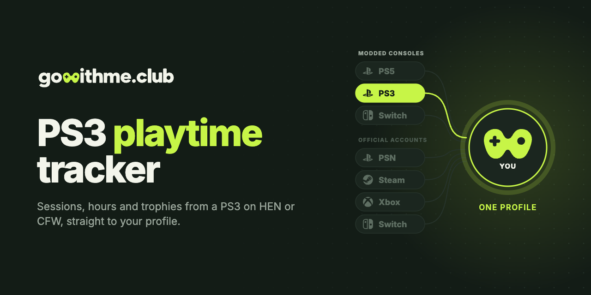

<p align="center">
  <a href="https://gowithme.club"></a>
</p>

<p align="center">
  <b>English</b> · <a href="README.ru.md">Русский</a>
</p>

<p align="center">
  <a href="https://github.com/gowithme-club/ps3-playtime-tracker/releases/latest"></a>
  
  <a href="LICENSE"></a>
</p>

# PS3 Playtime Tracker

An open-source VSH plugin that tracks playtime, play sessions and trophies on a
PS3 with PS3HEN or custom firmware and syncs them to your
[gowithme.club](https://gowithme.club) profile. No PSN account needed.

**Requires:** a PS3 on CFW, or on HFW with PS3HEN, with webMAN installed, and a free gowithme.club account.<br>
**Tested on:** 4.92 HFW with PS3HEN 3.5.0.

## Features

- Every play session with its start, end and length, for disc, HDD and PSN games.
- Trophies read from the profile on the console, without PSN.
- Live “playing now” status on your profile; the XMB shows how long you played.
- Reports queue on the HDD and survive being offline or powered off.
- Starts with the console after the first successful run.

## Install

The step-by-step guide is in **Settings → PS3 (CFW)** on gowithme.club. In short:

1. On gowithme.club issue a token and download `gwm.sprx` and `gwm.cfg`
   (the token is already inside).
2. Copy both files over FTP to `/dev_hdd0/plugins/`.
3. Wait a couple of minutes after the XMB appears, then open
   `http://<console-ip>/loadprx.ps3?prx=/dev_hdd0/plugins/gwm.sprx` in a browser.

A notification with the plugin version and your profile name confirms it works.
The plugin is also on the [releases page](https://github.com/gowithme-club/ps3-playtime-tracker/releases/latest).
More help: [docs/TROUBLESHOOTING.md](docs/TROUBLESHOOTING.md).

## FAQ

**How do I track playtime on a PS3 with HEN or CFW?**
Install this plugin with a token from gowithme.club. Sessions, hours and
trophies then show up on your profile.

**Do I need a PSN account?**
No. Trophies are read from the profile on the console.

**Does it work with PS3HEN?**
Yes. It was tested on 4.92 HFW with PS3HEN 3.5.0. CFW works the same way.

**Does it start by itself?**
Yes. After the first successful run it adds itself to `/dev_hdd0/autoexec.bat`.
Add `autostart = false` to `gwm.cfg` to turn that off.

**Does it work offline?**
Yes. Reports wait on the HDD and go out once the console is online.

**Can it count playtime from before it was installed?**
No. The PS3 keeps no playtime history, so only games played with the plugin
running are counted.

**What does it send?**
The game's title ID, name and version, where it was launched from, session
length, unlocked trophies, the console profile name, and the firmware and plugin
versions. The console is identified by a salted hash; the PSID and IDPS never
leave it. Without a token in `gwm.cfg` it sends nothing.

**How do I remove it?**
Delete `gwm.sprx` and `gwm.cfg` from `/dev_hdd0/plugins/` and the `gwm.sprx`
line from `/dev_hdd0/autoexec.bat`. If the XMB does not start, power the console
off and boot it without enabling HEN first.

## Build from source

The plugin is a PRX, which the open PSL1GHT toolchain cannot build, so Sony's
Cell SDK 4.75 is also required. It is proprietary and not included.

```bash
make toolchain     # open ps3dev toolchain into ~/ps3dev
make test-host     # host tests, no console needed
make sprx          # needs the Cell SDK in ~/ps3sdk/cell
```

Build host, signing and console measurements (in Russian): [docs/DEVELOPMENT.ru.md](docs/DEVELOPMENT.ru.md).

## Other consoles

| Console | Repository | Runs as |
| --- | --- | --- |
| PS5, jailbroken | [ps5-playtime-tracker](https://github.com/gowithme-club/ps5-playtime-tracker) | payload |
| PS3 on HEN or CFW | **ps3-playtime-tracker** | VSH plugin |
| Switch with Atmosphere | [switch-playtime-tracker](https://github.com/gowithme-club/switch-playtime-tracker) | sysmodule |

Stock PS4 and PS5, Steam, Xbox, Nintendo Switch and Discord connect on
[gowithme.club](https://gowithme.club) without installing anything.

## Support

[Telegram support](https://t.me/gowithme_club_support) ·
[GitHub issues](https://github.com/gowithme-club/ps3-playtime-tracker/issues) ·
pull requests are welcome.

## License

[MIT](LICENSE).

Unofficial homebrew, not affiliated with or endorsed by Sony Interactive
Entertainment. PlayStation and PS3 are trademarks of their respective owners.
