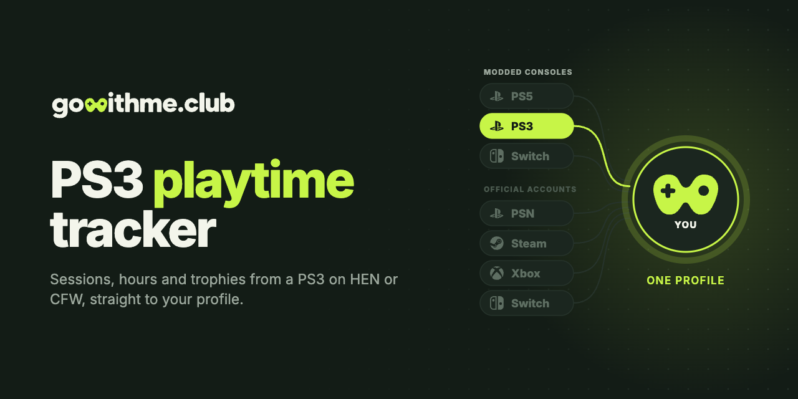

<p align="center">
  <a href="https://gowithme.club"></a>
</p>

<p align="center">
  <a href="README.md">English</a> · <b>Русский</b>
</p>

<p align="center">
  <a href="https://github.com/gowithme-club/ps3-playtime-tracker/releases/latest"></a>
  
  <a href="LICENSE"></a>
</p>

# Трекер игрового времени для PS3

VSH-плагин с открытым кодом: считает игровое время, сессии и трофеи на PS3 с
PS3HEN или кастомной прошивкой и отправляет их в ваш профиль на
[gowithme.club](https://gowithme.club). Аккаунт PSN не нужен.

**Нужно:** PS3 с CFW или с HFW и PS3HEN, установленный webMAN и бесплатный аккаунт gowithme.club.<br>
**Проверено:** 4.92 HFW с PS3HEN 3.5.0.

## Возможности

- Каждая сессия с началом, концом и длительностью — для игр с диска, HDD и из PSN.
- Трофеи из профиля на консоли, без PSN.
- Статус «сейчас играет» в профиле; при выходе из игры XMB покажет, сколько вы играли.
- Очередь отчётов лежит на HDD и переживает офлайн и выключение консоли.
- После первого успешного запуска стартует вместе с консолью.

## Установка

Пошаговая инструкция — на gowithme.club в **Настройки → PS3 (CFW)**. Коротко:

1. На gowithme.club выпустите токен и скачайте `gwm.sprx` и `gwm.cfg`
   (токен в нём уже записан).
2. Положите оба файла по FTP в `/dev_hdd0/plugins/`.
3. Подождите пару минут после появления XMB и откройте в браузере
   `http://<ip-консоли>/loadprx.ps3?prx=/dev_hdd0/plugins/gwm.sprx`.

Уведомление с версией плагина и именем профиля значит, что всё работает.
Плагин есть и на [странице релизов](https://github.com/gowithme-club/ps3-playtime-tracker/releases/latest).
Если что-то не так — [docs/TROUBLESHOOTING.md](docs/TROUBLESHOOTING.md).

## Вопросы

**Как считать игровое время на PS3 с HEN или CFW?**
Установите этот плагин с токеном из gowithme.club. Сессии, часы и трофеи
появятся в профиле.

**Нужен ли аккаунт PSN?**
Нет. Трофеи читаются из профиля на консоли.

**Работает с PS3HEN?**
Да. Проверено на 4.92 HFW с PS3HEN 3.5.0. На CFW работает так же.

**Запускается сам?**
Да. После первого успешного запуска он прописывает себя в
`/dev_hdd0/autoexec.bat`. Чтобы отключить, добавьте в `gwm.cfg` строку
`autostart = false`.

**Работает без интернета?**
Да. Отчёты ждут на HDD и уходят, когда консоль выйдет в сеть.

**Посчитает время, сыгранное до установки?**
Нет. PS3 не хранит историю игрового времени, поэтому учитываются только игры,
запущенные при работающем плагине.

**Что он отправляет?**
Title ID, название и версию игры, откуда она запущена, длительность сессии,
выбитые трофеи, имя профиля консоли, версии прошивки и плагина. Консоль
опознаётся солёным хешем: PSID и IDPS её не покидают. Без токена в `gwm.cfg`
плагин не отправляет ничего.

**Как удалить?**
Удалите `gwm.sprx` и `gwm.cfg` из `/dev_hdd0/plugins/` и строку с `gwm.sprx`
из `/dev_hdd0/autoexec.bat`. Если XMB не запускается, выключите консоль и
включите её, не активируя HEN.

## Сборка из исходников

Плагин — это PRX, а открытый тулчейн PSL1GHT собрать его не может, поэтому
нужен ещё Cell SDK 4.75 от Sony. Он проприетарный и в репозиторий не входит.

```bash
make toolchain     # открытый тулчейн ps3dev в ~/ps3dev
make test-host     # тесты на компьютере, консоль не нужна
make sprx          # нужен Cell SDK в ~/ps3sdk/cell
```

Билд-хост, подпись и замеры на консоли: [docs/DEVELOPMENT.ru.md](docs/DEVELOPMENT.ru.md).

## Другие консоли

| Консоль | Репозиторий | Что ставится |
| --- | --- | --- |
| PS5 с джейлбрейком | [ps5-playtime-tracker](https://github.com/gowithme-club/ps5-playtime-tracker) | пейлоад |
| PS3 с HEN или CFW | **ps3-playtime-tracker** | VSH-плагин |
| Switch с Atmosphere | [switch-playtime-tracker](https://github.com/gowithme-club/switch-playtime-tracker) | sysmodule |

Обычные PS4 и PS5, Steam, Xbox, Nintendo Switch и Discord подключаются на
[gowithme.club](https://gowithme.club) без установки чего-либо.

## Поддержка

[Поддержка в Telegram](https://t.me/gowithme_club_support) ·
[issues на GitHub](https://github.com/gowithme-club/ps3-playtime-tracker/issues) ·
пулреквесты приветствуются.

## Лицензия

[MIT](LICENSE).

Неофициальный homebrew, не связан с Sony Interactive Entertainment и не одобрен
ею. PlayStation и PS3 — товарные знаки своих владельцев.
